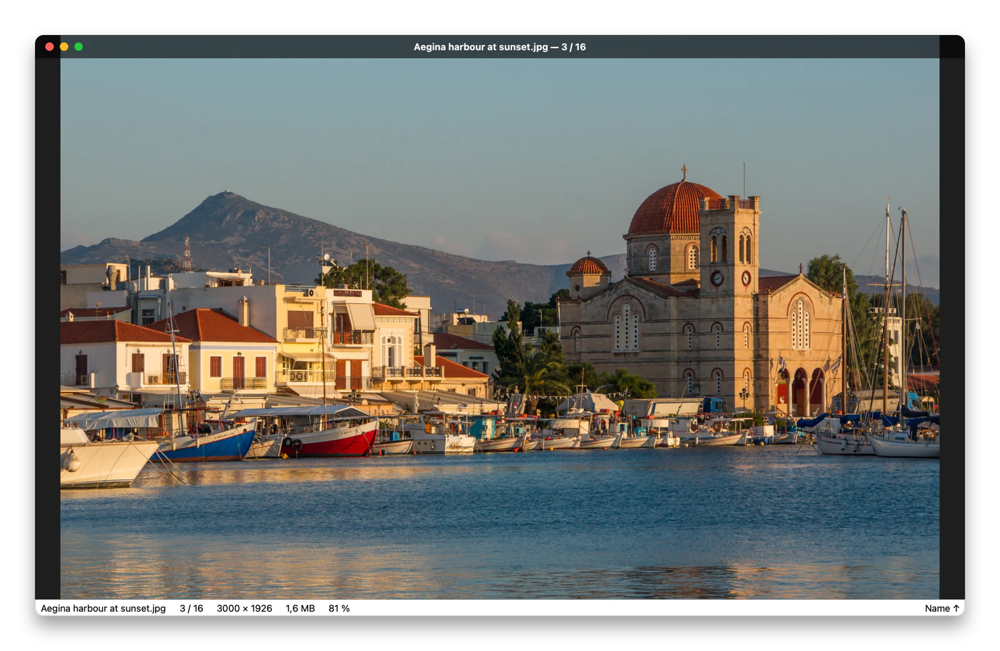
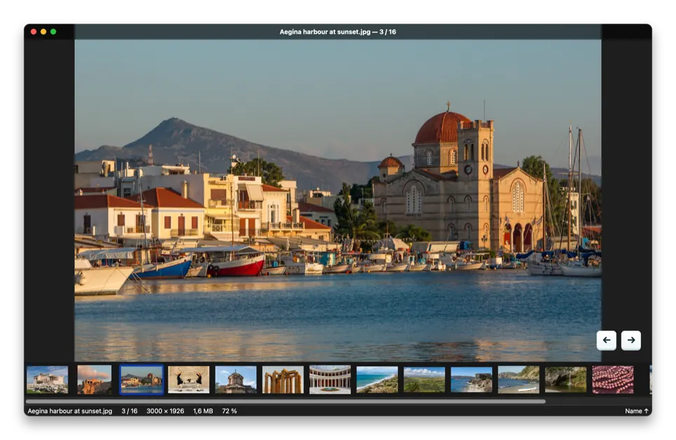
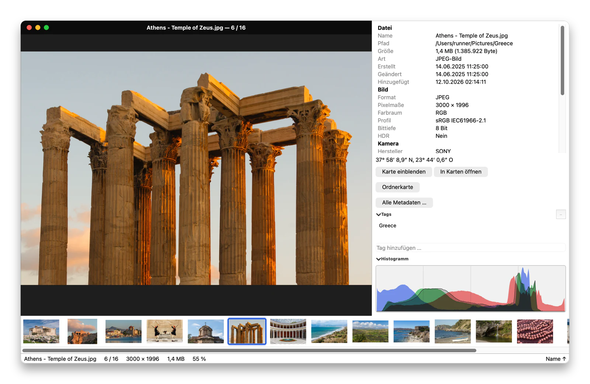
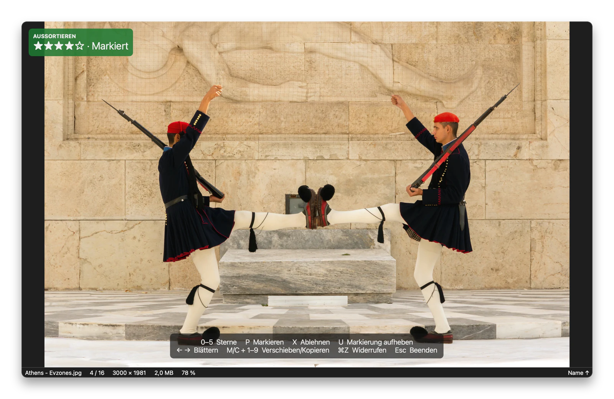
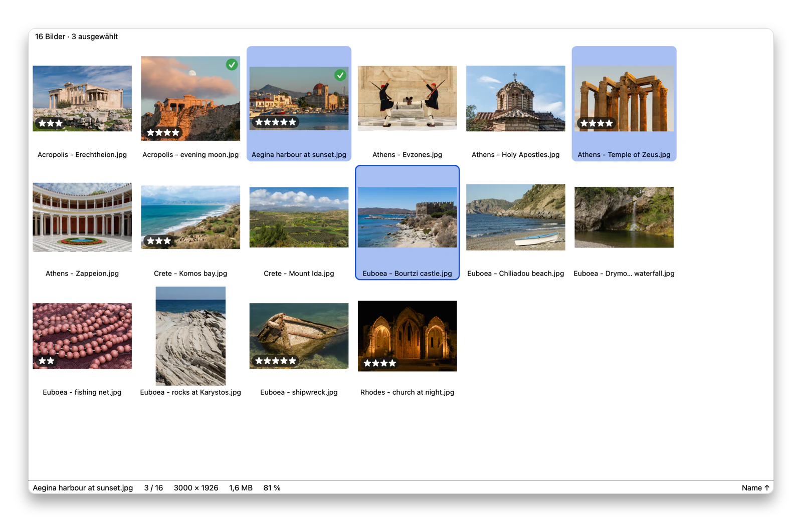
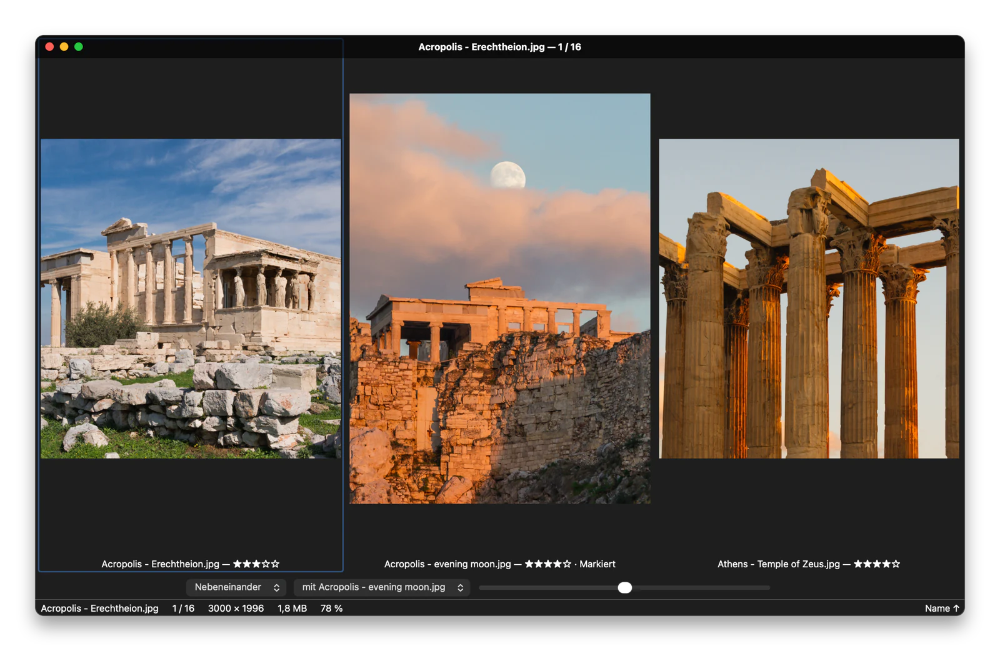
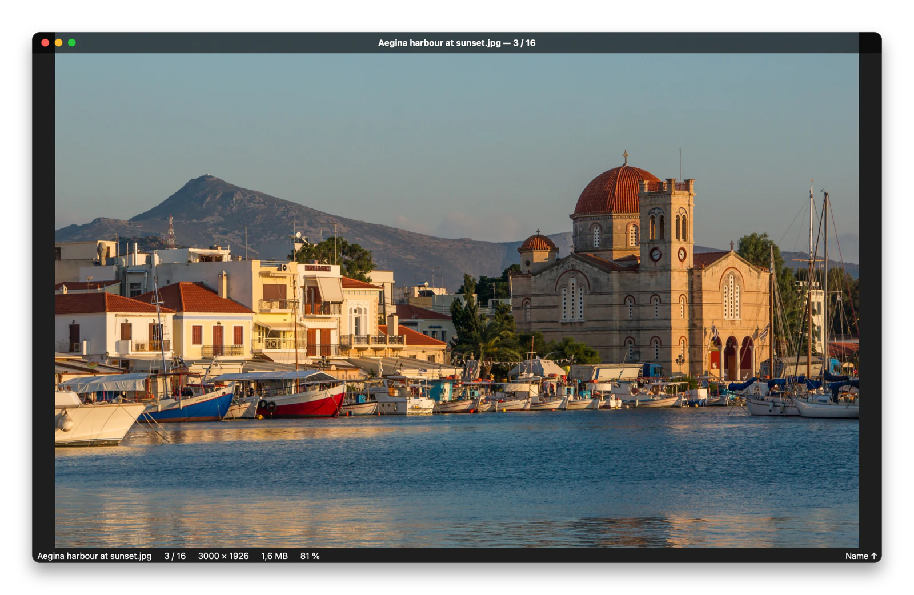
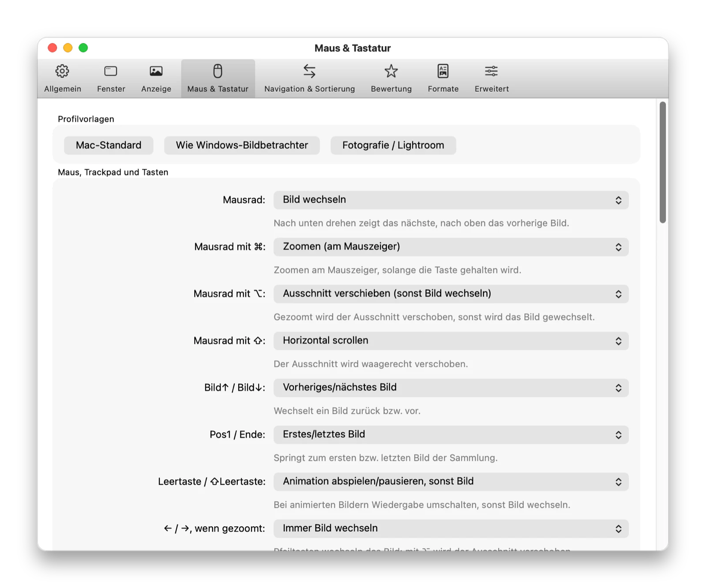

<!-- SPDX-License-Identifier: GPL-3.0-or-later -->
[English](README.md) · **Deutsch**

<div align="center">

# Lumaflip

**Schneller, freier Bildbetrachter für macOS – Doppelklick auf ein Foto, dann mit ← / → ohne Wartezeit durch den ganzen Ordner, in Finder-Reihenfolge.**

[](https://github.com/brokoskokoli/lumaflip/actions/workflows/ci.yml)
[](LICENSE)
[](#installation)
[](https://github.com/brokoskokoli/lumaflip/releases)

<picture>
  <source media="(prefers-color-scheme: dark)" srcset="docs/images/viewer-de-dark.webp">
  
</picture>

[](https://github.com/brokoskokoli/lumaflip/releases/latest)

</div>

> **Status:** Version 1.2 (Meilenstein M4) ist das erste öffentliche Release – siehe [CHANGELOG.md](CHANGELOG.md).
> Die ausführliche Dokumentation ist auf Englisch ([README.md](README.md)); die Spezifikation
> [SPEC.md](SPEC.md) ist auf Deutsch.

## Warum Lumaflip?

Vorschau.app blättert nach einem Doppelklick **nicht** mit den Pfeiltasten durch die anderen Bilder
des Ordners. Lumaflip zeigt das Bild sofort, lädt den ganzen Ordner im Hintergrund, sortiert ihn
**wie das Finder-Fenster** und lädt die Nachbarbilder vor. Ohne Abo, ohne Konto, ohne Telemetrie.

<p align="center">
  
</p>

## Funktionen (Auswahl)

- **Wie im Finder blättern:** Ordner per Doppelklick, Finder-Sortierung (auch live vom
  Finder-Fenster, Opt-in), Ordner bleibt aktuell, Unterordner, Nachbarordner (⌥← / ⌥→),
  „Gehe zu Bild“ (⌘G), Schnellfilter (⌘F), mehrere und gekoppelte Fenster.
- **Formate ohne Nachinstallation:** JPEG, PNG, GIF, WebP, TIFF, HEIC/HEIF, AVIF, JPEG XL, RAW,
  PSD/PSB, XCF, OpenEXR, Radiance HDR, JPEG 2000, SVG (resvg), QOI, PCX, PNM, SGI, OpenRaster,
  Krita u. v. m.; Animationen und mehrseitige Dateien.
- **Farbe und HDR/EDR:** ICC-Profile, Display P3, CMYK; HDR-Fotos mit echter Spitzlicht-Helligkeit
  auf XDR-Displays, SDR-Vorschau, Belichtungsregler.
- **Aussortieren und Bewerten:** Aussortiermodus (⌘K), Sterne, Markieren/Ablehnen, Bewertungen als
  Lightroom-kompatible XMP-Zusatzdatei, im Bild oder als Finder-Tags; Schnellablage
  `M`/`C` + `1`–`9`.
- **Raster, Vergleich (2–4 Bilder synchron), Lupe, Ordnerkarte (⇧⌘M), Infopanel mit Histogramm.**
- **18 Sprachen**, Wechsel ohne Neustart (maschinell übersetzt, Korrekturen willkommen).
- **Datenschutz:** keine Telemetrie, kein Festplattenvollzugriff; seltene Formate werden in einem
  abgeschotteten Hilfsprozess dekodiert.

Alle Funktionen und Tastenkürzel: [README.md](README.md#features) (Englisch).

## Bildschirmfotos

<table>
  <tr>
    <td width="50%"><a href="docs/images/info-de-light.webp"></a><br><sub><b>Infopanel und Filmstreifen</b>: Kameradaten, Histogramm, Finder-Tags.</sub></td>
    <td width="50%"><a href="docs/images/culling-de-dark.webp"></a><br><sub><b>Aussortieren</b> (⌘K): Sterne, Markieren, Ablehnen – als Lightroom-kompatibles XMP gespeichert.</sub></td>
  </tr>
  <tr>
    <td width="50%"><a href="docs/images/grid-de-light.webp"></a><br><sub><b>Raster</b> (G) mit Mehrfachauswahl: mehrere Bilder auf einmal bewerten, verschieben, vergleichen.</sub></td>
    <td width="50%"><a href="docs/images/compare-de-dark.webp"></a><br><sub><b>Vergleich</b> von 2–4 Bildern mit synchronem Zoom und Verschieben.</sub></td>
  </tr>
  <tr>
    <td width="50%"><a href="docs/images/viewer-de-dark.webp"></a><br><sub><b>Hell und dunkel</b>: folgt dem Erscheinungsbild des Systems.</sub></td>
    <td width="50%"><a href="docs/images/preferences-de-light.webp"></a><br><sub><b>Eigene Tasten, eigene Maus</b>: jedes Kürzel und jeder Klick ist änderbar.</sub></td>
  </tr>
</table>

Die Bildschirmfotos entstehen automatisch aus der echten App
([`tools/screenshots`](tools/screenshots), [Ablauf](docs/RELEASING.md#screenshots-und-demo-animation)).
Beispielfotos: Jebulon, [Wikimedia Commons](https://commons.wikimedia.org/wiki/User:Jebulon), CC0
(gemeinfrei); die vollständige Liste mit Quellen steht in
[`tools/screenshots/sample-photos.json`](tools/screenshots/sample-photos.json).

## Installation

### macOS

Voraussetzung: macOS 15 (Sequoia) oder neuer, Apple-Silicon-Mac.

- **Homebrew:**

  ```sh
  brew install --cask brokoskokoli/lumaflip/lumaflip
  ```

  Der Cask liegt im eigenen Tap [brokoskokoli/homebrew-lumaflip](https://github.com/brokoskokoli/homebrew-lumaflip)
  und wird mit jedem Release aktualisiert. Lumaflip aktualisiert sich selbst, deshalb lässt
  `brew upgrade` es aus (`brew upgrade --greedy` nicht). Nach Aufnahme in `homebrew/cask` genügt
  `brew install --cask lumaflip`.
- **DMG:** `Lumaflip-<version>.dmg` aus dem
  [neuesten Release](https://github.com/brokoskokoli/lumaflip/releases/latest) laden, öffnen,
  Lumaflip nach „Programme“ ziehen (signiert und notarisiert). Prüfsumme:
  `shasum -a 256 -c Lumaflip-<version>.dmg.sha256`.

### Windows (Vorschau)

Windows 10 (1809) oder 11, x64.

- **Installer:** `Lumaflip-<version>-windows-x64-setup.exe` aus dem
  [neuesten Release](https://github.com/brokoskokoli/lumaflip/releases/latest). Installiert pro
  Benutzer (ohne Administratorrechte), trägt Lumaflip unter „Öffnen mit“ und „Einstellungen →
  Standard-Apps“ ein und übernimmt keinen Dateityp ungefragt. Installierte Kopien aktualisieren
  sich selbst.
- **Portabel:** `Lumaflip-<version>-windows-x64.zip` aus demselben Release entpacken und
  `Lumaflip.exe` starten.
- **winget** *(in Vorbereitung)*: nach Aufnahme in das Paketverzeichnis von winget
  `winget install Brokoskokoli.Lumaflip`.

Releases sind mit Authenticode signiert (Azure Artifact Signing). HEIC, AVIF, WebP, JPEG XL und RAW
über die Codec-Erweiterungen aus dem Microsoft Store. Details: [docs/WINDOWS.md](docs/WINDOWS.md)
(Englisch).

### Linux (Vorschau)

Für x86_64-Linux (glibc 2.39+, z. B. Ubuntu 24.04 oder neuer) baut die CI ein **AppImage**
(Artefakt `Lumaflip-linux-x86_64-AppImage` des Jobs „Linux app“): `chmod +x
Lumaflip-<version>-x86_64.AppImage`, dann starten. *Ablage → Als Standard-App festlegen …* macht
es zum Bildbetrachter. HEIC braucht einen separat installierten HEVC-Decoder; Live Text, Quick
Look, Karten und HDR (EDR) gibt es nur auf dem Mac. Details, Bauen und Sandbox:
[docs/LINUX.md](docs/LINUX.md) (Englisch).

## Aus dem Quellcode bauen

```sh
brew install cmake ninja qt jpeg-turbo googletest clang-format resvg
tools/run.sh [bild]                    # nur die App bauen und starten
tools/check.sh --quick --no-gui        # Build + Unit-Tests ohne Fenster
```

Linux: `cmake -S . -B build/linux -G Ninja && cmake --build build/linux`, AppImage mit
`tools/linux_appimage.sh build/linux dist` (Abhängigkeiten in [docs/LINUX.md](docs/LINUX.md)).
Windows (MSVC, Qt msvc2022_64, vcpkg): `cmake --preset windows-release`, siehe
[docs/WINDOWS.md](docs/WINDOWS.md).

## Mitmachen

Siehe [CONTRIBUTING.md](CONTRIBUTING.md), [Verhaltenskodex](CODE_OF_CONDUCT.md),
[Sicherheit](SECURITY.md) und [Übersetzungen](translations/README.md).

## Lizenz

GPL-3.0-or-later, siehe [LICENSE](LICENSE). Drittanbieter-Lizenzen: *Über Lumaflip → Lizenzen von
Drittanbietern …* bzw. `Lumaflip.app/Contents/Resources/licenses/`.
