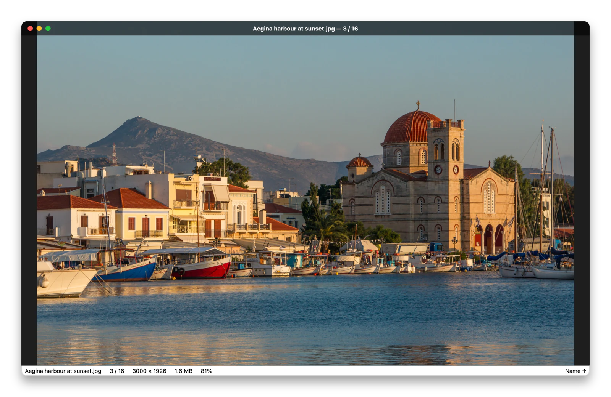
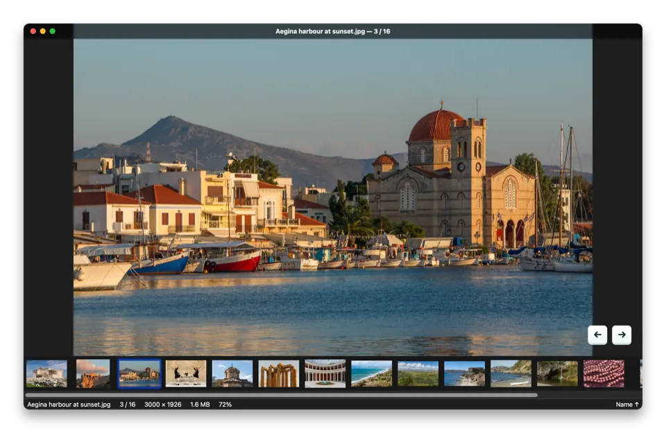
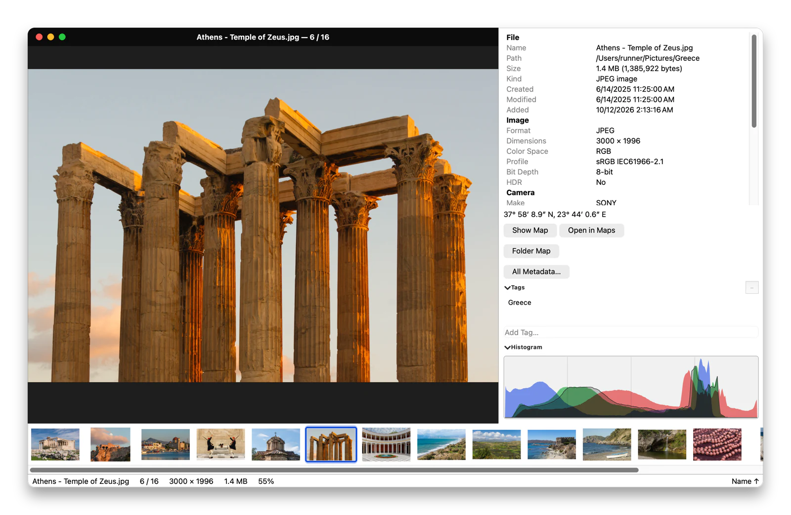
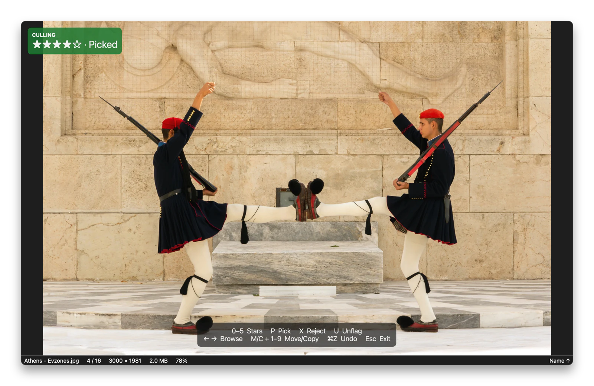
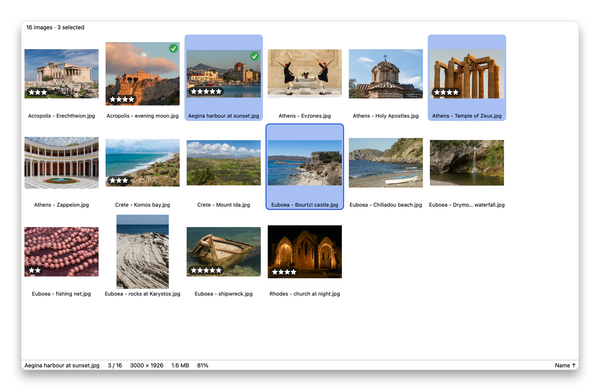
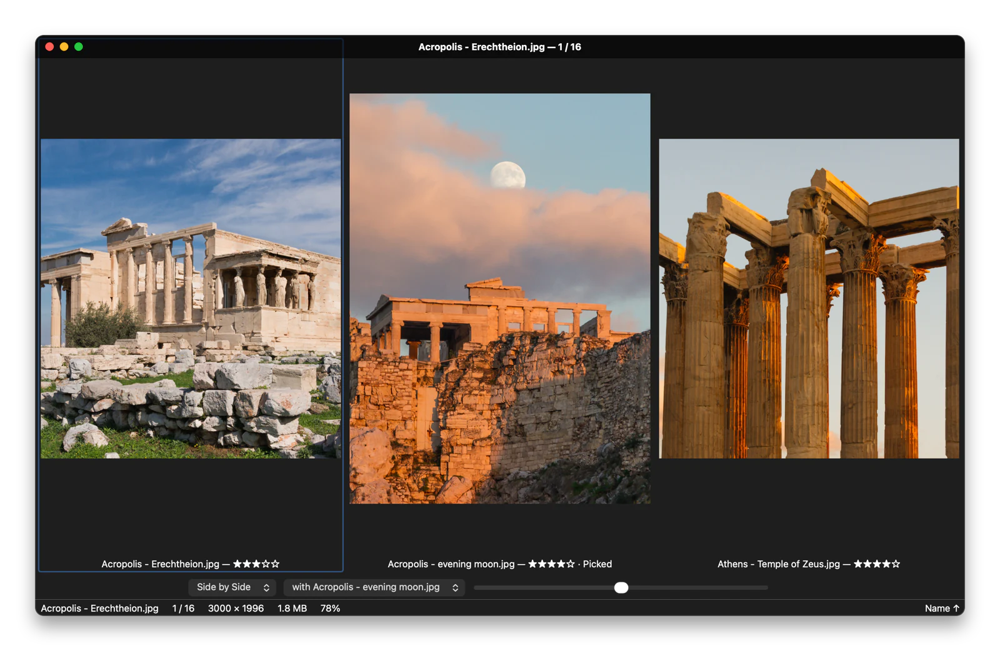
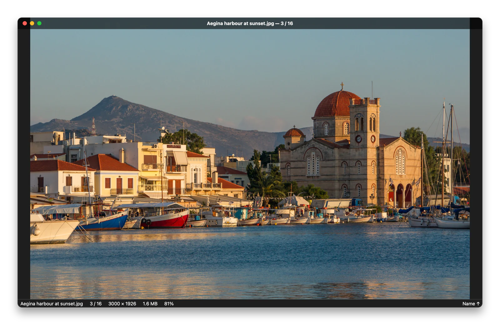
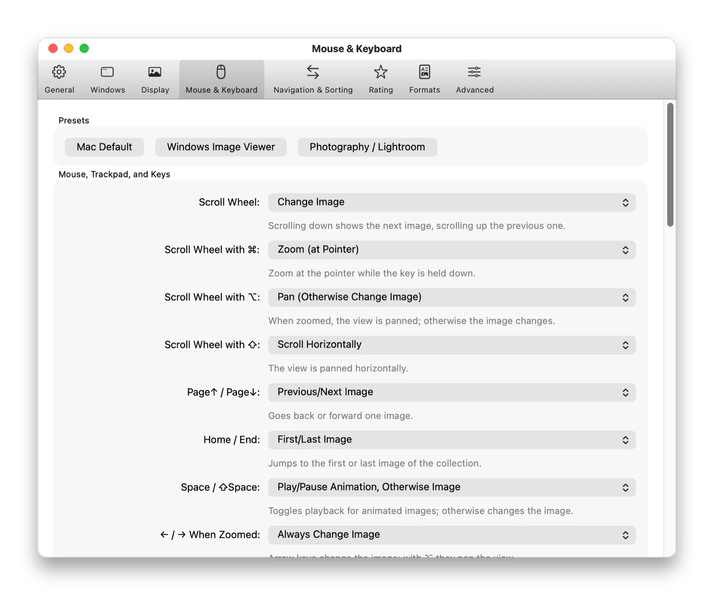

<!-- SPDX-License-Identifier: GPL-3.0-or-later -->
**English** · [Deutsch](README.de.md)

<div align="center">

# Lumaflip

**A fast, free image viewer for macOS. Double-click a photo, then flip through the whole folder in Finder order with no waiting.**

[](https://github.com/brokoskokoli/lumaflip/actions/workflows/ci.yml)
[](LICENSE)
[](#install)
[](https://github.com/brokoskokoli/lumaflip/releases)
[](https://github.com/brokoskokoli/homebrew-lumaflip)

<picture>
  <source media="(prefers-color-scheme: dark)" srcset="docs/images/viewer-en-dark.webp">
  
</picture>

[](https://github.com/brokoskokoli/lumaflip/releases/latest)

</div>

> **Status:** version 1.2 (milestone M4) is the first public release. See the [changelog](CHANGELOG.md)
> and the [roadmap](#roadmap).

## Why Lumaflip?

In macOS Preview, double-clicking a photo opens *just that photo*. The arrow keys can't take you
to the next image in the folder unless you select every file first and open them together.
Quick Look closes when you click, has no real zoom and steps through non-images too.

Lumaflip opens the image **instantly**, loads the **whole folder** in the background, sorts it
**the way the Finder window shows it** (name, date modified, date added, size, even icon
positions), and preloads the neighbours so ← / → is immediate. It is free software with no
subscription, no account and no telemetry.

<p align="center">
  
</p>

## Features

**Browse like Finder**
- Opening one image opens its whole folder. Flip with ← / →, the trackpad, the scroll wheel or the
  space bar. Non-images are skipped.
- **Finder sort order**: Lumaflip reads the folder's view settings (list, icon and gallery view,
  sort column and direction). It can also ask the frontmost Finder window directly (opt-in). If you
  pick a sort order yourself, Lumaflip remembers it per folder.
- Folders stay live: new, deleted and renamed files appear right away and the current image stays put.
- Include subfolders, jump to the sibling folder (⌥← / ⌥→), go to image *n* (⌘G), shuffle, and filter
  by file name (⌘F).
- Multiple windows with tiling, tabs and restore. **Linked windows** flip, zoom and pan together.

**Formats** (built in, nothing extra to install)
- JPEG, PNG, GIF, BMP, TIFF, WebP, ICO, ICNS, **HEIC/HEIF, AVIF, JPEG XL**
- **RAW** from most cameras (CR2, CR3, NEF, ARW, DNG, RAF, ORF, RW2, …), shown from the embedded preview first
- **PSD and PSB** (Photoshop Large Document), **XCF** (GIMP, visible layers composited), OpenRaster, Krita
- **OpenEXR**, Radiance HDR, JPEG 2000, TGA, DDS, KTX, **QOI**, PCX, PBM/PGM/PPM/PFM, SGI
- **SVG** (full SVG 1.1 with CSS, filters and text via resvg)
- Animations (GIF, APNG, WebP, AVIF/HEICS, JPEG XL) with pause, frame stepping and speed;
  multi-page TIFF/ICO/HEIF with page navigation. See the [FAQ](docs/FAQ.md#which-formats-are-supported).

**Colour and HDR**
- ICC profiles, Display P3 and CMYK are handled correctly. The colour profile follows the window
  when you move it to another display.
- **HDR/EDR**: iPhone HEIC, Ultra HDR JPEG, HDR AVIF and OpenEXR show real highlight brightness on
  XDR and other EDR displays. Includes an SDR preview toggle and a view-only exposure control.

**Culling and ratings**
- **Culling mode** (⌘K): 0–5 stars, pick / reject, and optional auto-advance after rating.
- Ratings are stored where other tools can read them: **Lightroom-compatible XMP sidecars**
  (also read by Capture One and darktable), embedded XMP, and/or Finder tags.
- Filter by rating. Move all rejects to the Trash or to a `_Rejected` folder in one step.
- **Quick move/copy**: `M` / `C` + `1`–`9` sends the image to one of nine preset folders, with
  undo and name-conflict handling.
- RAW+JPEG pairs can optionally be treated as a single image.

**Grid, compare, loupe**
- Grid view with multi-select, a filmstrip, and side-by-side comparison of 2–4 images with
  synchronised zoom and pan.
- Hold `L` for a 100 % / 200 % loupe under the cursor. Lock the zoom (⇧Z) to check focus across a burst.

**Folder map and metadata**
- **Folder map** (View → Folder Map, ⇧⌘M): every geotagged image in the folder on one map, with nearby
  points clustered. The current image is highlighted and follows as you flip.
- Info panel with file, image and camera data, a histogram and Finder tags, plus a window listing
  all raw EXIF/IPTC/XMP metadata.

**Made for the Mac**
- Native menus, light and dark mode, full-screen mode, a slideshow, lossless JPEG rotation, rename,
  Share, drag out to other apps, and one-click "Set as Default App for Images".
- Every shortcut and mouse/trackpad action can be remapped, with conflict detection and presets
  ("Mac Default", "Windows Image Viewer", "Photography / Lightroom").
- Automatic, signed updates via Sparkle (can be turned off).

**Multilingual**: available in 18 languages. It follows the system language, or you can pick one
and switch without restarting. [Translations](#translations) are machine-made so far, and reviews
are welcome.

**Private by design**
- No telemetry, no account, no cloud. The only network traffic is the update check (can be turned
  off) and map tiles, which load only after you click "Show Map".
- No Full Disk Access needed.
- Decoders for less common formats (SVG, XCF, PSB, QOI, …) run in a **sandboxed helper process**
  with no network and no write access. A malformed file cannot crash the app.

## Screenshots

<table>
  <tr>
    <td width="50%"><a href="docs/images/info-en-light.webp"></a><br><sub><b>Info panel and filmstrip</b>: camera data, histogram, Finder tags.</sub></td>
    <td width="50%"><a href="docs/images/culling-en-dark.webp"></a><br><sub><b>Culling mode</b> (⌘K): stars, pick and reject, saved as Lightroom-compatible XMP.</sub></td>
  </tr>
  <tr>
    <td width="50%"><a href="docs/images/grid-en-light.webp"></a><br><sub><b>Grid</b> (G) with multi-select: rate, move or compare several images at once.</sub></td>
    <td width="50%"><a href="docs/images/compare-en-dark.webp"></a><br><sub><b>Compare</b> 2–4 images with synchronised zoom and pan.</sub></td>
  </tr>
  <tr>
    <td width="50%"><a href="docs/images/viewer-en-dark.webp"></a><br><sub><b>Light and dark</b>: follows the system appearance.</sub></td>
    <td width="50%"><a href="docs/images/preferences-en-light.webp"></a><br><sub><b>Your keys, your mouse</b>: every shortcut and click can be remapped.</sub></td>
  </tr>
</table>

The screenshots are taken automatically from the real app by
[`tools/screenshots`](tools/screenshots) ([how](docs/RELEASING.md#screenshots-und-demo-animation)).
Sample photos: Jebulon, [Wikimedia Commons](https://commons.wikimedia.org/wiki/User:Jebulon), CC0
(public domain); the full list with sources is in
[`tools/screenshots/sample-photos.json`](tools/screenshots/sample-photos.json).

## Install

### macOS

Requirements: **macOS 15 Sequoia or later** on an **Apple Silicon** Mac.

- **Homebrew**:

  ```sh
  brew install --cask brokoskokoli/lumaflip/lumaflip
  ```

  The cask lives in our own tap, [brokoskokoli/homebrew-lumaflip](https://github.com/brokoskokoli/homebrew-lumaflip),
  and is updated with every release. Lumaflip updates itself, so `brew upgrade` leaves it alone
  (`brew upgrade --greedy` does not). Once the cask is accepted into `homebrew/cask`, the command
  will be `brew install --cask lumaflip`.
- **DMG**: download `Lumaflip-<version>.dmg` from the
  [latest release](https://github.com/brokoskokoli/lumaflip/releases/latest), open it and drag
  Lumaflip into Applications. Releases are signed with a Developer ID and notarized by Apple. To
  verify the download: `shasum -a 256 -c Lumaflip-<version>.dmg.sha256`.

The first time you open an image from Desktop, Documents, Downloads, a removable drive or a network
volume, macOS asks once for access. Lumaflip needs to read the image's folder so you can flip
through it.

### Windows (preview)

Requirements: **Windows 10 (1809) or 11**, x64.

- **Installer**: `Lumaflip-<version>-windows-x64-setup.exe` from the
  [latest release](https://github.com/brokoskokoli/lumaflip/releases/latest). It installs per user
  (no administrator rights), registers Lumaflip under *Open with* and *Settings → Default apps*
  and never takes over a file type. Installed copies update themselves.
- **Portable**: `Lumaflip-<version>-windows-x64.zip` from the same release; unpack and start
  `Lumaflip.exe`.
- **winget** *(pending)*: once the package is accepted into the Windows Package Manager
  repository, `winget install Brokoskokoli.Lumaflip`.

Release builds are Authenticode-signed (Azure Artifact Signing). HEIC, AVIF, WebP, JPEG XL and RAW
use the codec extensions from the Microsoft Store. Details, differences to macOS and known gaps:
[docs/WINDOWS.md](docs/WINDOWS.md).

### Linux (preview)

An **AppImage** for x86_64 Linux (glibc 2.39+, e.g. Ubuntu 24.04 or newer) is built by CI
(artifact `Lumaflip-linux-x86_64-AppImage` of the "Linux app" job):
`chmod +x Lumaflip-<version>-x86_64.AppImage` and run it. *File → Set as Default App…* registers it
as your image viewer. HEIC needs a separately installed HEVC decoder; Live Text, Quick Look, maps
and HDR (EDR) are macOS-only. Details, building from source and the sandbox: [docs/LINUX.md](docs/LINUX.md).

## Quick start

1. Double-click an image (or choose *Open With → Lumaflip*). To make Lumaflip your default viewer,
   choose *File → Set as Default App…* (or *Settings → Formats*). You can deselect individual file types.
2. Flip with ← / →. Press `?` to see every shortcut.
3. Press `I` for the info panel, `T` for the filmstrip and `G` for the grid.
4. To cull a shoot, press ⌘K, rate with `1`–`5`, `P` (pick) and `X` (reject), then choose
   *Move All Rejected to Trash…*.

### Default keyboard shortcuts

All of these can be remapped in *Settings → Mouse & Keyboard*.

| Action | Keys |
|---|---|
| Next / previous image | → / ←, Space / ⇧Space, Page Down / Page Up, scroll wheel, mouse buttons 4/5 |
| First / last image | Home / End, ⌘↑ / ⌘↓ |
| Next / previous folder | ⌥→ / ⌥← |
| Zoom in / out | ⌘+ / ⌘−, `+` / `−`, pinch |
| Fit / 100 % / fill width | ⌘9 or `1` / ⌘0 or `3` / `2` |
| Toggle fit ↔ 100 % at cursor | `Z` |
| Lock zoom while flipping | ⇧Z |
| Loupe (hold) | `L` |
| Full screen / leave mode | ⌃⌘F, `F`, double-click / Esc |
| Slideshow | ⇧⌘F, `S` (during a slideshow, `1`–`9` set the interval in seconds) |
| Rotate left / right | ⌘L / ⌘R (save rotation: ⌘S) |
| Flip horizontal / vertical | `H` / ⇧H |
| Info panel / filmstrip / grid | ⌘I or `I` / `T` / `G` |
| Folder map | ⇧⌘M |
| Go to image / filter by name | ⌘G / ⌘F |
| Move to Trash / undo / redo | ⌘⌫ or Delete / ⌘Z / ⇧⌘Z |
| Rename | Return, F2 |
| Reveal in Finder | ⇧⌘R |
| Copy image / copy path | ⌘C / ⌥⌘C |
| Open in editor | `E` |
| Culling mode | ⌘K, `K` |
| Rate / pick / reject / clear | `0`–`5` / `P` / `X` / `U` (in culling mode, where the digits rate instead of zoom) |
| Quick move / copy to folder *n* | `M` + `1`–`9` / `C` + `1`–`9` |
| Animation: play/pause / step | Space / `,` `.` |
| Next / previous page | ⌥↓ / ⌥↑ |
| HDR on/off / exposure ± / reset | ⇧⌘H / ⌥⌘+ ⌥⌘− / ⌥⌘0 |
| New window / duplicate window | ⌘N / ⌥⌘N |
| Settings / shortcut overview | ⌘, / `?` |

## Build from source

```sh
brew install cmake ninja qt jpeg-turbo googletest clang-format resvg
tools/fetch_sparkle.sh                 # optional: Sparkle for automatic updates
tools/run.sh [image]                   # build only the app and start it
tools/check.sh --quick --no-gui        # build + unit tests (no windows opened)
tools/package.sh                       # self-contained app + DMG/ZIP in dist/ (ad-hoc signed)
```

On Linux: `cmake -S . -B build/linux -G Ninja && cmake --build build/linux`, then
`tools/linux_appimage.sh build/linux dist` for an AppImage; dependencies are listed in
[docs/LINUX.md](docs/LINUX.md).

On Windows (MSVC, Qt msvc2022_64, vcpkg): `cmake --preset windows-release`, see
[docs/WINDOWS.md](docs/WINDOWS.md).

Qt 6.11 from Homebrew. resvg is optional; without it, SVG falls back to Qt SVG. More detail is in
[CONTRIBUTING.md](CONTRIBUTING.md), and signing, notarization and releases are covered in
[docs/RELEASING.md](docs/RELEASING.md).

## Roadmap

Milestones M1–M3 are done (see the [changelog](CHANGELOG.md)). Planned for **M4**:

- Browse archives (ZIP/CBZ, RAR/CBR, 7z) and PDF like folders
- Live Text and subject lift-out (VisionKit)
- Simple crop, export and convert
- Photo overlays: focus points, clipping warnings, focus peaking
- Custom actions (shell command or Shortcuts on a key)
- **Windows and Linux builds**. The core is already platform-neutral and builds on Linux in CI.

The full specification (in German) is [SPEC.md](SPEC.md).

## Contributing

Bug reports, ideas, translations and pull requests are welcome. Please read
[CONTRIBUTING.md](CONTRIBUTING.md) first. Features are specified before they are implemented
(spec-first), every requirement has an ID, and tests reference those IDs. This project follows the
[Code of Conduct](CODE_OF_CONDUCT.md). Report security issues privately as described in
[SECURITY.md](SECURITY.md).

## Translations

The UI ships in English, German, French, Spanish, Italian, Portuguese (Brazil and Portugal), Dutch,
Polish, Swedish, Danish, Norwegian Bokmål, Finnish, Czech, Japanese, Chinese (Simplified and
Traditional) and Korean. Except for German (the source language), the translations are
**machine-translated and not yet reviewed**. Corrections from native speakers are very welcome:
see [translations/README.md](translations/README.md) and the per-language status in
[translations/REVIEW_STATUS.md](translations/REVIEW_STATUS.md), or open a
[translation issue](https://github.com/brokoskokoli/lumaflip/issues/new?template=translation.yml).

## Documentation

[docs/README.md](docs/README.md) indexes all documents, including the [FAQ](docs/FAQ.md), the
specification, manual test plans and the release process.

## License

Lumaflip is free software, licensed under the **GNU General Public License v3.0 or later**
(GPL-3.0-or-later); see [LICENSE](LICENSE). The repository follows the [REUSE](https://reuse.software)
specification ([REUSE.toml](REUSE.toml)).

Third-party components in the app bundle include Qt (LGPLv3, dynamically linked and replaceable),
libjpeg-turbo (BSD-style, statically linked, for lossless JPEG rotation), resvg (Apache-2.0/MIT, SVG
in the decoder helper) and Sparkle (MIT, updates). You can see every bundled component and its
licence under *About Lumaflip → Third-Party Licenses…*, and the full texts are in
`Lumaflip.app/Contents/Resources/licenses/`.

## Acknowledgements

Lumaflip builds on [Qt](https://www.qt.io), Apple ImageIO,
[libjpeg-turbo](https://libjpeg-turbo.org), [resvg](https://github.com/linebender/resvg) and
[Sparkle](https://sparkle-project.org). Many ideas come from viewers that came before it:
FastStone and qimgv (quick move by digit), FastRawViewer (pick/reject with `_Rejected`), nomacs
(linked windows), ImageGlass (digit zoom modes), Phoenix Slides (slideshow interval by digit) and
GNOME Loupe/glycin (sandboxed decoders).
